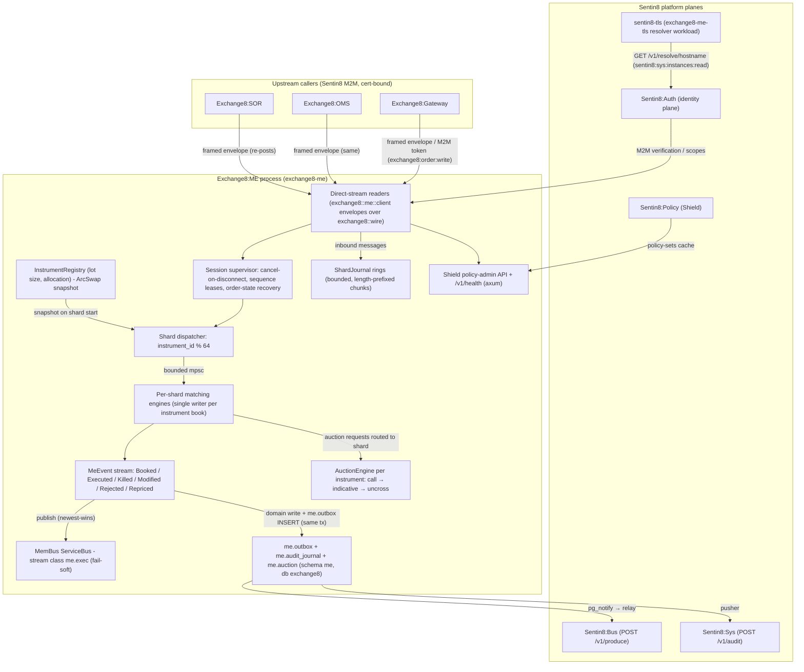

# Exchange8:ME

## 1. Summary

Exchange8:ME (Matching Engine) is the deterministic central-limit-order-book (CLOB)
matching core of the exchange8 vertical - the capital-markets matching tier of
the Sentin8 platform. It accepts order-entry events from Exchange8:Gateway, Exchange8:OMS,
and Exchange8:SOR re-posts, executes them against per-instrument order books in
memory, and emits the complete order-lifecycle and trade event stream
(bookings, executions, kills, modifications, rejections, reprices). The engine
preserves canonical matching semantics - price-time priority, per-contract
allocation policies (FIFO / pro-rata), broker preferencing, board/odd-lot
separation, iceberg reload with time-priority reset, post-only, price
protection, self-trade prevention, halts, and quotation-only state - and adds
call auctions (opening / closing / volatility / IPO / reopen / halt) with
indicative-imbalance publication and maximum-volume uncrossing.

The matching core is a pure Rust library (`services/me/src/engine.rs`): no
clock, no allocation dependency on the caller, no database on the hot path.
The service binary wraps it in the Sentin8 platform shell (`sentin8::shell`):
axum HTTP/TLS surface, `--print-registration` self-registration, DB pool,
allocator, and graceful drain. Event fan-out rides the platform planes: a
MemBus `me.exec` stream class for realtime adopters, a local `me.outbox`
relayed to Sentin8:Bus, and an `me.audit_journal` pushed to Sentin8:Sys.

## 2. Motivation

- **Exact, defensible fill semantics.** A matching engine's business value is
  fairness under audit. Fill order must be provably strict (FIFO prefix on
  FIFO instruments, deterministic largest-remainder pro-rata on futures), or
  every downstream reconciliation disputes. The engine is a *pure* core: the
  same input sequence always yields the identical trade stream, so journal
  replay is a defense, not a best effort.
- **Sub-envelope latency without sacrificing platform guarantees.** Order
  books live in memory, per instrument; the durable surface is deliberately
  tiny (auction sessions, outbox, audit) so the hot path never waits on I/O.
- **No bespoke infrastructure.** Identity, TLS, policy administration, event
  durability, and audit delivery are all platform services (Sentin8:Auth,
  `sentin8-tls`, Shield, Sentin8:Bus, Sentin8:Sys); the binary only owns the
  matching domain.
- **Deterministic recovery.** Every inbound message is journaled per shard
  (bounded ring → length-prefixed binary chunks); recovery rebuilds books by
  replaying the journal with the same engine - identical input, identical
  state.
- **Auction-grade market quality.** Opens, closes, and volatility events
  clear through a single call-auction price that maximizes matched volume,
  with published indicative price and imbalance so participants can react
  before the uncross.

## 3. Architecture & High-Level Design

The engine is **multi-shard and memory-resident**: every event for instrument
*i* is routed to exactly one shard (`instrument_id % N_SHARDS`, 64 by
default), and each shard is a single writer for its instruments' books. Book
mutation therefore needs no locks. The HTTP surface carries only health and
the shared Shield policy-admin API; order flow arrives on direct framed
streams from the upstream services.

The shell (`main.rs`) boots registration, the DB pool (`EXCHANGE8_ME_DATABASE_URL`),
the MemBus handle, and the router (`/v1/health` + Shield policy-admin). The
deterministic engine modules - `engine.rs` (books + matching), `shard.rs`
(dispatcher + registry), `journal.rs` (journal, trade-id lease, price
protection decisions), `auction.rs` (call auctions) - are free of tokio, DB,
and clock dependencies, which is what makes replay and unit testing exact.

## 4. Key Traits and Data Structures

- **MatchingEngine** - the pure matching core: a map of instrument books plus
  a trade-id source and an ordered event sink. Every inbound operation
  (add / cancel / modify / erase / instrument status / market status) is a
  method call that mutates books and appends lifecycle events; nothing else
  is observable about the core's internals.
- **InstrumentBook** - one book pair per instrument: a *board* book (whole
  lots) and an *odd* book (odd-lot tail volume), each with market/bid and
  market/ask sides, the instrument status (Open / Halted / QuotationOnly),
  lot size, and the contract's within-level fill discipline (`fifo` or a
  pro-rata variant). Mixed quantities split into a board portion and an odd
  portion that never match each other across books.
- **Book / PriceLevel / RestingOrder** (`crates/book`) - the ordered level
  map: best-first iteration for the match walk, O(1) locate/cancel/reduce by
  order id, FIFO front-filling; visible and hidden (iceberg) volume live on
  distinct levels so bypass orders only touch visible liquidity.
- **MeEvent** - the outbound lifecycle set: `Booked`, `Killed`, `Modified`,
  `Filled`, `Rejected`, `Executed`, `Repriced`. Executions carry a common
  trade id, the passive-side price, liquidity flags (active = removed,
  passive = added), and counterparty identity; both sides of every fill are
  emitted as separate events.
- **InstrumentRegistry / RegistryHandle** (`shard.rs`) - the immutable
  snapshot of per-instrument contract metadata (lot size, allocation
  method), loaded at startup and swapped atomically on refresh; readers get a
  consistent snapshot per clone, never torn state.
- **ShardJournal** (`journal.rs`) - the per-shard input journal: a bounded
  ring of journaled messages drained as one length-prefixed binary chunk,
  rotated per session; decode is total (truncated or corrupt chunks read
  short, never panic).
- **TradeIdLease** (`journal.rs`) / **SequenceLease** (`exchange8::wire`) -
  the in-process 10k-batch lease over the platform-managed sequence; the
  vertical ships no sequence table of its own - lease blocks are handed out
  in memory and refilled from the platform store (UPDATE…RETURNING supplied
  by the shell).
- **AuctionEngine** (`auction.rs`) - one call-auction session per instrument:
  accumulates orders during the call, publishes indicative price / matched
  volume / imbalance, and uncrosses at the price maximizing matched volume
  (tie-breaks: smallest imbalance, then closest to the reference price).

## 5. Rationale, Trade-offs, and Alternatives

- **Pattern choices.**
  - *Pure core + thin shell.* Matching lives in clock-free, allocation-free
    structs; the shell owns I/O, identity, and persistence. Determinism is
    the property that makes recovery, replay, and audit reconciliation
    trustworthy - a core that touches tokio or the DB cannot be replayed
    bit-exactly.
  - *Shard-by-instrument.* `instrument_id % N_SHARDS` gives disjoint single-writer
    domains with zero coordination - the same shape as classic dispatcher
    pools, expressed as one bounded mpsc per shard. No distributed lock, no
    per-book mutex.
  - *Outbox-first events.* Lifecycle and trade events are emitted in memory
    and durably staged in `me.outbox` (same transaction as any domain write)
    before the relay forwards them, so a Valkey outage never drops or
    duplicates a trade event (idempotency key = outbox row id).
- **Dispatching.** Within-level allocation is a data-driven enum
  (`AllocationMethod` from the contract master), not a trait-object strategy:
  the policies are a closed set per contract, dynamic dispatch would put a
  vtable on the hot path for no extensibility benefit, and the enum keeps the
  allocation function pure and table-testable.
- **Concurrency.** Bounded tokio mpsc per shard (backpressure is the failure
  mode, not unbounded queues); the registry is swapped atomically
  (copy → mutate → swap) so hot readers pay one `Arc` clone; the MemBus
  handle fails soft - an unreachable Valkey degrades publishing to a warning,
  never a startup failure, because the exchange must keep matching.
- **Rejected alternatives.**
  - *Shared book + global lock*: simplifies cancel-anywhere but serializes
    the whole venue; sharding preserves single-writer determinism at 64×
    concurrency.
  - *Write trades to the DB on the hot path*: adds per-fill commit latency
    and couples matching to pool health; trades are event-consumed downstream
    (Clearing) and the ME owns only the in-flight lifecycle plus the journaled
    input for replay.
  - *Per-message journal fsync*: durability per message would dominate
    latency; the bounded ring + chunk flush keeps the hot path allocation and
    syscall-light while recovery still sees every accepted input in order.
  - *Hash-map book*: O(1) price lookup but loses best-first iteration, which
    the match walk relies on to avoid rescans; the ordered level map pays
    O(log L) insert for an allocation-free hot walk.

## 6. Internal Implementation & Invariants (Private Design)

- **AddOrder pipeline (fixed order of checks).** halted → reject; QuotationOnly →
  plain display limit orders book without matching (other types reject);
  post-only → cross-check both books, kill if it would immediately match,
  else book unchanged; price protection → sidestep one tick from the
  protected opposite best and emit `Repriced`; then match, then book the
  remainder (unless IOC/FOK/Bypass kill it). Order-id-less book creation is
  safe only because the registry hydrates metadata before traffic - a book
  created from the lazy default would freeze lot 100 / FIFO for the
  instrument's lifetime.
- **Lot split.** Quantity is split into `qty / lot_size` board units plus the
  odd remainder; the board portion matches only opposite board levels, the
  odd portion only odd levels. FX and crypto shape instruments register
  `lot_size = 1`, making the split a no-op so fractional quantities trade.
- **FIFO prefix discipline.** On a `fifo` contract, a sweep fills orders
  `1..k` fully, `k+1` partially, and never touches later orders at the level;
  an aggressive order whose odd part cannot match books the odd remainder
  even at the same price. Pro-rata contracts allocate the level proportionally
  in one decision (largest-remainder residue, arrival-order ties).
- **Broker preferencing.** Two passes over the opposite side: first levels
  containing orders from the incoming order's own customer (even at worse
  prices), then the rest - applied per pass before allocation.
- **Iceberg reload.** When the visible slice of a resting iceberg depletes,
  the reload shows `min(max_floor, remaining)`, bumps the sub-order count,
  and reinserts the order at the FIFO tail - reload resets time priority.
- **STP.** Matching `stp_key` pairs apply the active order's action:
  KillActive (active remainder killed), KillPassive (resting removed), KillBoth,
  Decrement (reduce the active need by the would-be fill); FOK orders skip
  STP. Decrement treats the pair as skipped, keeping the passive side intact.
- **Executions.** One `Executed` per side per fill with a common `trade_id`;
  execution price is always the passive price; trade ids come from the
  10k in-process lease (`NeedLease` → shell refill).
- **Modify reality.** Any modification re-keys the order (`new_order_id`),
  adjusts remaining/display/floor, and reinserts at the tail - every modify
  loses time priority; a modify that reduces remaining to zero kills the
  order (`ModifyRequest`); a full reduction is a kill, not a cancel.
- **Halt / quotation-only boundaries.** An instrument halt kills every
  resting order (reason `InstrumentHalted`) and rejects new orders;
  quotation-only accepts plain display limits only. Market-wide status routes
  to the fan-out shard for book-wide treatment.
- **Recovery surface.** `all_order_states()` implements the all-orders state
  request (every resting order's remaining volume); `erase_order` drops an
  order silently (no notify to the originator) - the Gateway-driven
  reconciliation model (unknown-but-live → erase; qty mismatch → cancel).
- **Journal framing.** `[n:u32] ([len:u32][bytes])×n`, one type byte +
  deterministic payload per entry; `decode_chunk` is total (garbage reads
  short, never panics), so replay of a torn tail is safe.
- **Invariants always true:** one writer per instrument book; every accepted
  input journaled in order before its effects are observable downstream;
  strict FIFO on `fifo` instruments (CI-enforced); fills ≤ resting (no
  oversell); Σ active fills = Σ passive fills per execution; identical input
  sequence ⇒ identical event stream.

## 7. Unresolved Questions / Future Designs

- The egress stack is wired (per-shard journals → journal writer chunks,
  `MeEvent` drain → outbox-writer batching 1000/5 ms, MemBus fail-soft
  publisher, RFW pages `engine`/`auctions` mounted); the INBOUND direct
  streams (Gateway/OMS/SOR readers over `exchange8::wire`) await the peer
  services' frame senders - the ingest helpers (`ingest_add` / `ingest_cancel`
  / `ingest_modify`) and the shard dispatcher are live, the cross-service
  reader task lands with the gateway stream contract epic.
- The master design's REST admin endpoints (`/v1/admin/books/{id}` depth
  snapshot, order erase) remain part of the broader books admin surface.

---

**Architecture & Design:** exchange8:me and its underlying concepts were designed by [Hamid Jahanzad](https://www.linkedin.com/in/hamidjahanzad/).
